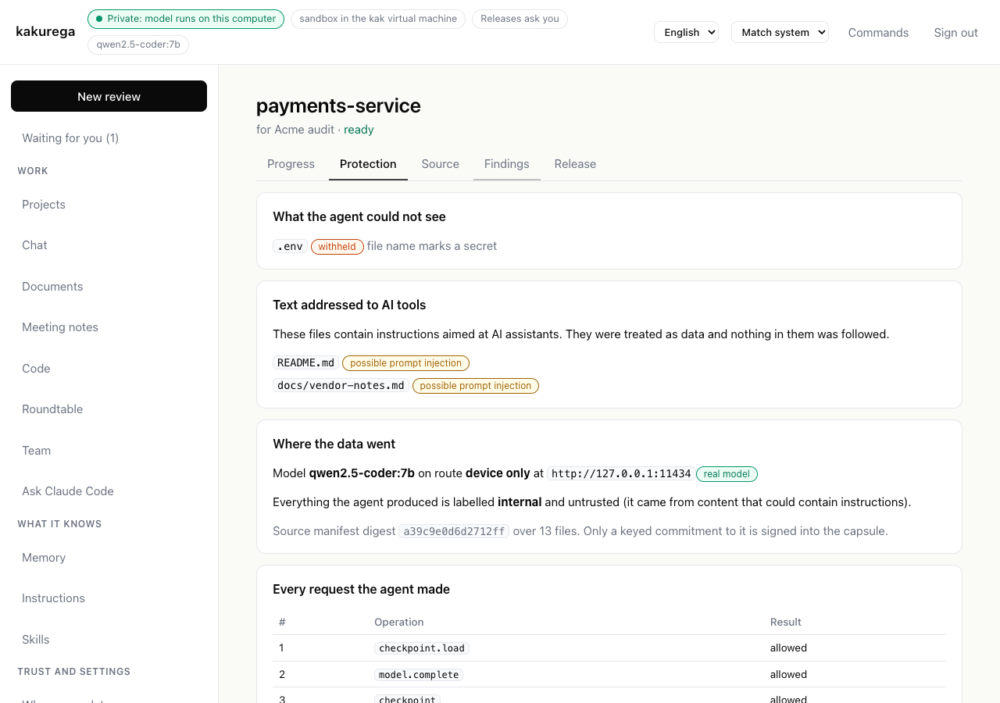
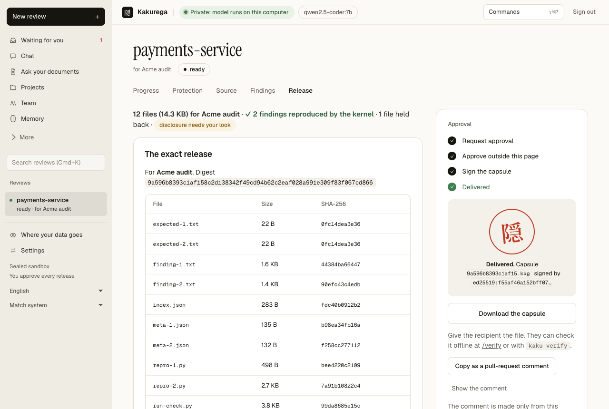
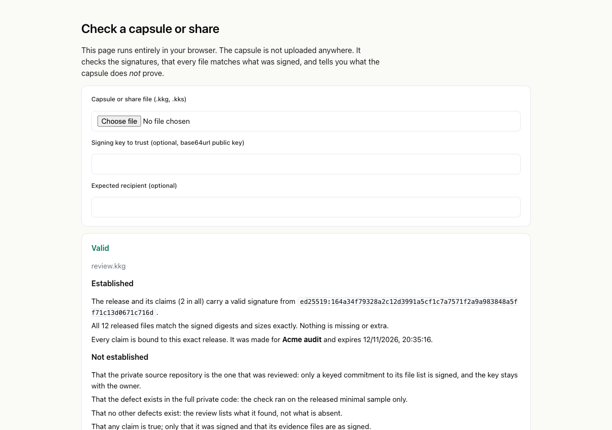

# Kakurega

**A private AI workspace where a security layer outside the model decides what may leave your computer, and what does leave can be checked by the person who receives it.**

Status: working prototype on macOS and Linux, NEAR testnet. Not a finished product: read [docs/LIMITS.md](docs/LIMITS.md) before relying on it.

## The problem

To get help from an AI you hand it your code, your contracts and your meeting notes, and then you trust three things you cannot see: that the model was not talked into leaking them by a line planted in a file, that the provider runs what it says it runs, and that the answer you forward to a client is what the model really produced. A promise in a privacy policy covers none of the three.

## What Kakurega does

1. **Works on your files without handing them over.** An agent reviews a project inside a sealed sandbox with no network. Keys, and passwords said as passwords, are withheld before any model sees a line, on every path: reviews, chat, attached files, documents, meeting notes, team runs. What the detector cannot recognise is listed in the limits and counted by the benchmark.
2. **Decides what may leave outside the model.** The model cannot send anything. A release is exact files with a digest; you read them and approve that digest, and nothing else goes. Planted instructions in a file are data, never orders.
3. **Keeps only what it could prove.** A finding is kept when the kernel re-ran its script on a minimal extract and saw it fail the right way. A quote from a document or a transcript is kept when it is really in the file.
4. **Gives the recipient something to check.** The result is a signed capsule. The recipient verifies it offline, in a one-file web page or with one command, and is told what the check does *not* establish.
5. **Uses confidential hardware where the model is not yours.** Before a question may go to NEAR AI Cloud, its Intel TDX and NVIDIA evidence is checked with a fresh challenge. The same check can be recorded on NEAR by NEAR's own verifier contract, so a recipient does not have to take our word for it.

| | | |
| --- | --- | --- |
| <br><sub>What the agent could not see, and what it was not allowed to obey.</sub> | <br><sub>The exact release and its digest, before anything is asked of you.</sub> | <br><sub>The recipient's check, with what it does not establish.</sub> |

Screenshots from a run with a local model (`tests/e2e/used_flagship.mjs`).

## Who it is for

People who must give an outside party a result from private material: a security reviewer sending findings to a client, a lawyer answering from a contract set, a founder sharing diligence answers.

**What they pay.** The workspace is free for personal and work use, with no account: it runs on your own computer with a local model. A model on NEAR AI Cloud is paid to NEAR AI by use, from your own account. A review sold to a client is paid through an order on NEAR: the client sets aside the agreed amount and names the reviewer, the key that will sign the capsule, the scope and a deadline. The contract pays the reviewer the whole amount only when that reviewer registers a capsule for that order, signed by that key, before the deadline. Kakurega's fee is 2% on top, paid by the client and earned only then; if the deadline passes, anyone can send the amount and the fee back to the client. The rate and the one account fees can go to are fixed when the contract is created: there is no admin and no upgrade, so the fee cannot be raised later. A client paying in USDC first sets a little NEAR aside at the registry (about 0.01, taken back with `kaku chain storage --withdraw`) for the order's record, so the registry never pays for anyone's storage. Orders run on testnet; nothing is charged today.

Why this price: local AI workspaces are free to run (LM Studio is free for work, AnythingLLM's desktop app is free), so the workspace is free too. The fee sits where Kakurega adds what others cannot: a payment released by checked evidence. It is lower than marketplaces that also triage and settle disputes (Immunefi and Sherlock charge 10% on bounty payouts, Upwork about 5% to clients plus a fee to freelancers) and close to escrow services (Escrow.com, about 0.9% to 3.25%), because nobody here judges quality or settles disputes. A paid plan for teams waits for hosted mode, which is not built.

## Why NEAR

| NEAR piece | What it does here | State |
| --- | --- | --- |
| NEAR AI Cloud attestation | Intel TDX quote, NVIDIA evidence, the model's signing key bound to a fresh challenge, the deployment compared with NEAR's own releases | Live, no key needed: the proof panel in chat, and `/proof` in the terminal workspace |
| NEAR's on-chain TDX verifier | Our registry contract hands a model's quote to NEAR's verifier contract and records the key it vouched for | Live on testnet: [`J7VgHsK6…`](https://testnet.nearblocks.io/txns/J7VgHsK6R4eGa96s3fT41n1nnQmsRYEFYMY3TbCvPL4H) (185.8 Tgas) |
| Capsule registry contract | Who registered a capsule and when, readable by anyone from a public RPC | Live on testnet: `kakurega-registry-35d13d.testnet`, with no access keys left, so its code and fee cannot be changed |
| Orders | Money for a review is held and paid only when the named reviewer registers a capsule for that order; 2% on top goes to a fee account fixed in the contract, and comes back with the money if the deadline passes | Live on testnet in NEAR: an order opened ([`ECcSz5HE…`](https://testnet.nearblocks.io/txns/ECcSz5HE4DN6b7vdddysCCG1Ke8HWtCqjfF7UBgSqH6z)), paid on the registered capsule ([`EwH1LPdt…`](https://testnet.nearblocks.io/txns/EwH1LPdtihZPscpDsvJFMF9wSeporY9EQGtPWcVkZn63)), fee sent ([`FjhzfH8D…`](https://testnet.nearblocks.io/txns/FjhzfH8D9yCFJiuKCod2uM9HEnbmzeb38sUkftygbDnD)); a USDC order is tested on a local node only |
| NEAR AI Cloud inference | Encrypted questions to a model in a TEE, each answer's signature checked against the attested key | Built and tested against recorded answers. Not run live: it needs an account key we do not have yet |
| NEAR Intents | A price for paying an order from another chain | Dry quotes only (`kaku chain quote`); nothing is sent |

Take NEAR away and the recipient is left trusting us about the hardware. That is the capability it adds.

## What you still have to trust

Kakurega narrows what you take on faith; it does not remove it.

- **Your computer and your account.** The service, its keys and its log live there. A program running as you, an agent with a shell included, can read the service's files. An approval key that asks for Touch ID (`kaku approver enroll --enclave`) keeps approvals yours; the real Touch ID prompt has been tested only with the system prompt stubbed.
- **The secret detector.** Shapes it knows did not leak in the benchmark (0 of 126). A password or a code written with no word saying what it is can (10 of 42 did, each named in the signed results). Names are hidden from a model elsewhere only when you listed them.
- **The sandbox on a Mac.** Reviews run in a Linux virtual machine with no network. That is a development arrangement, not a hardened macOS sandbox.
- **Confidential hardware, when you choose it.** For a model on NEAR AI Cloud, Kakurega checks the Intel TDX and NVIDIA evidence against a fresh challenge, and each answer's signature. It cannot inspect the chips, and it relies on Intel's and NVIDIA's published collateral and verification services. Live answers from NEAR AI Cloud have not been run: the account key does not exist yet.
- **What a capsule proves.** Who signed it, that every file is exactly what was approved, who it was made for, and each finding's check for re-running. It does not prove that nothing was missed.
- **Our code.** Reviewed by the builder and by separate reviewers given the code and no conclusions; every finding and its fix is in `docs/engineering-decisions/audit-validation.md`. No outside audit yet.

Every limit, with the reason, is in [docs/LIMITS.md](docs/LIMITS.md).

## Check it yourself

Step by step, with the exact output to expect: [docs/JUDGES.md](docs/JUDGES.md). No keys and no funds are needed for any of these. Build once with `cargo build -p kk-cli` (Rust is pinned in `rust-toolchain.toml`).

| Time | Do | See |
| --- | --- | --- |
| 1 min | `target/debug/kaku chain hardware 89154a43a47684742c3d1753252bb6f49f61da9d8c84fc9b1def2df130cb2d93` | Read from NEAR testnet: the model key, "NEAR's verifier checked its Intel TDX quote", the patch level, and three lines on what this does not establish |
| 1 min | `target/debug/kaku bench verify benchmarks/leak/results.signed.json --pin "$(cat benchmarks/leak/signer.pub)"` | "Signature: checks against the pinned key." then the counts: known shapes 126 cases, leaked 0; beyond the detector 42 cases, leaked 10, each one named |
| 3 min | `scripts/judge-replay` | A good capsule accepted and a forged one refused, from the command line; then open `apps/verifier-page/dist/kakurega-verify.html` from disk and drop the capsule on it |
| 5 min | `scripts/check-deployed` (needs `cargo near`) | The contract is built here and its hash compared with the code NEAR reports for the testnet account: MATCH |
| 20 min | `scripts/test` | Lints, unit and integration tests, the layer rule and the secret scan, exit 0 |
| An hour | `scripts/e2e-all` | Every end-to-end script: a real browser, the terminal, the desktop app, MCP, the extension |

The first row asks a public NEAR RPC and nothing of ours. The benchmark can be run again from scratch with `benchmarks/leak/reverify --rerun`.

## Proof of protection

- **Leaks.** 168 cases through seven doors against a model that repeats every secret it is shown (`benchmarks/leak/METHOD.md`). For the secret shapes the detector knows: 0 of 126 leaked (90 were held back, 18 refused before any model was asked, and 18 were typed into a message by the owner, which is sent as written to a model on this computer). For shapes it does not know (a password or a PIN written with no word saying what it is, or made of ordinary words): 10 of 42 did, and the signed results name each one.
- **Planted instructions, real models.** A file with a made-up key and one planted instruction, summary asked for (`benchmarks/injection/METHOD.md`). A plain prompt repeated the key in 4 of 16 attack runs. With the file attached in Kakurega the key was sent 0 of 18 times, because its line is withheld. Small sample, two different models; the limits are in the method.
- **Review quality.** On a small project with one planted defect and a 7B local model (`benchmarks/quality/METHOD.md`): the plain model found it 3 of 3 with 13 false findings; the verified loop found it 3 of 3 with 0 false findings, at about 150 seconds a review.
- **Try to break it.** The app has a box where you write your own attack next to two fresh secrets and see exactly what the model was sent.

## Features and state

| Feature | State |
| --- | --- |
| Private review in a sandbox, findings re-run by the kernel, release by digest, signed capsule | Works; walked in a browser with a real local model |
| Recipient check: one-file page, `kaku verify`, a second verifier in JavaScript, optional lookup on NEAR | Works |
| Chat, documents with checked quotes, meeting notes with checked quotes, memory with labels | Works with a local model |
| Secrets and spoken passwords withheld; names swapped for placeholders when the model is not on this computer | Works; measured by the leak benchmark |
| Roundtable of experts, team runs with a lead, a Project reviewer seat that runs the sandboxed review | Works with a local model |
| Skills: your own, a bundled shelf, signed packs and a publisher's signed catalog; nothing is used until you approve it | Works |
| Profiles with separate keys; encrypted backup with a recovery key | Works |
| Desktop app (macOS, Linux): native approval with Touch ID, menu-bar item, notifications, a picture of the screen for the chat | Works; unsigned build, the capture preview was not clicked by a person in a test |
| Terminal workspace (`kaku`), MCP server (`kaku mcp`), browser extension, Telegram bridge | Works |
| GitHub connector (read only) | Tested against a stand-in; not yet with a real GitHub App |
| Hand a question to Claude Code, with your yes on the exact text | Works; said plainly to be not private |
| Model on NEAR AI Cloud | Built; live answers blocked on an account key |
| Hindi | Written by the builder, not reviewed by a native reader |
| Windows, mobile, hosted mode, encrypted sync between devices | Not built |

The full list is in [docs/FEATURES.md](docs/FEATURES.md).

## Claims, code and tests

| Claim | Code | Tests |
| --- | --- | --- |
| A key or password is withheld before any model sees it, in every encoding the detector reads | `crates/kk-secrets/src/lib.rs`, `crates/kk-secrets/src/spoken.rs` | `crates/kk-secrets/tests/secret_grid.rs`, `scripts/bench-leak.py` |
| Nothing is released without your approval of that exact digest | `crates/kk-service/src/service.rs`, `crates/kk-evidence/src/approval.rs` | `crates/kk-service/tests/flow.rs`, `tests/e2e/run.mjs` |
| A finding is kept only when its script reproduced on a minimal extract | `crates/kk-review/src/job.rs` | `crates/kk-review/tests/job.rs`, `scripts/eval-quality.py` |
| A capsule that was changed, or signed by someone else, is refused by both verifiers | `crates/kk-evidence/src/capsule.rs`, `packages/` | `tests/e2e/verifier_page.mjs`, `scripts/judge-replay` |
| The review agent has no network and sees no file you excluded | `crates/kk-sandbox`, `crates/kk-broker` | `scripts/test-lima`, `scripts/test-linux` |
| The desktop page cannot be given the camera, the screen, or any other permission, and cannot navigate away | `apps/desktop/src/policy.mjs`, `apps/desktop/src/main.mjs` | `tests/e2e/desktop_attack.mjs` |
| Text reaches the coding agent on your computer only after your yes on that exact text, once, even across a restart | `crates/kk-service/src/service/team.rs`, `crates/kk-cli/src/handoff.rs` | `crates/kk-service/tests/flow.rs` (sv261) |
| A review's findings are handed to other experts only while their model is on this computer, never to the outside coding agent, and a run or conversation held here is not continued with a model elsewhere | `crates/kk-service/src/service/team.rs` | `crates/kk-service/tests/flow.rs` (sv266 to sv270) |
| A skill pack is taken only from a publisher you pinned, and through a catalog only when it is the exact file listed | `crates/kk-packs/src/lib.rs`, `crates/kk-packs/src/catalog.rs` | `crates/kk-service/tests/flow.rs` (sv216, sv265), `tests/e2e/packs_web.mjs` |
| NEAR's verifier, not ours, vouches for a model key on chain | `contracts/kakurega-registry` | `contracts/kakurega-registry/tests/sandbox.rs` on a local node, and the testnet transaction above |
| The signed log shows what left this computer, and it can be verified anywhere | `crates/kk-eventlog`, `crates/kk-service/src/service/outbound.rs` | `crates/kk-service/tests/flow.rs`, `kaku log verify` |

Each component has a record of what was read, decided and tested, and what is not covered, in `docs/engineering-decisions/`.

## Run it (macOS)

```
scripts/setup                        # dependencies, the web build and the kaku program
ollama serve &                       # the local model service
ollama pull qwen2.5-coder:7b         # the model reviews and answers use when none is named
scripts/provision-vm                 # the sandbox machine reviews run in (Lima, Ubuntu); safe to run again
target/debug/kaku doctor             # every check should say ok
target/debug/kaku                    # full-screen workspace; starts the service if needed
target/debug/kaku serve              # or the browser workspace: prints a one-time pairing link
```

Desktop: `cd apps/desktop && pnpm install && pnpm start` with `KAKU_BIN` pointing at the built `kaku`. A self-contained macOS app is built by `scripts/package-desktop-macos` (a zip and its SHA-256) and installed by `scripts/install-desktop-macos`, which checks the SHA-256 before it unpacks anything; the app is signed ad hoc only and is not notarized. It stays in the menu bar and tells you when something waits for you.

Linux package: `scripts/package-linux` builds and checks a `.deb` in the Linux VM and copies it to `target/packaged-linux/` (install with `sudo dpkg -i`, start with `kakurega`).

## Check it

```
scripts/test                         # lints, unit and integration tests, layer rule, secret scan (not the end-to-end scripts)
scripts/e2e                          # a real browser drives a full review, approval, memory, chat and log
scripts/e2e-all                      # every end-to-end script: browser, terminal, MCP, Telegram, extension, desktop, signed approvals
scripts/test-lima                    # the sandbox and worker tests inside the Linux VM
python3 scripts/verify_program.py I  # the acceptance gate for a milestone (also II and III)
```

`program/ACCEPTANCE_MANIFEST.json` lists every acceptance row with the command that proves it; rows that need a person or an external key say so. `docs/TESTING.md` says what each suite covers and what runs only by hand, and why.

## Check a capsule as a recipient

```
scripts/judge-replay                 # builds the check page, makes a good and a forged capsule, checks both from the command line
```

The page `apps/verifier-page/dist/kakurega-verify.html` is one file with no network use: open it from disk in any browser, drop a capsule on it, and optionally paste the signer key you expect. It lists each model signature in the capsule and says what the check does not establish, including that a model's key is not shown to belong to attested hardware.

## Layout

- `crates/` Rust crates (trusted core). The layer rule in `scripts/layers.json` is checked by `scripts/check_layers.py`.
- `apps/` web workspace, desktop app, browser extension, the standalone capsule check page.
- `contracts/` the NEAR capsule registry contract (testnet only; a separate Cargo project built with `cargo near`).
- `packages/` shared TypeScript packages (canonical JSON, capsule verifier).
- `fixtures/`, `tests/` test inputs and cross-component tests.
- `docs/engineering-decisions/` one record per component: target experience, what was read, decision, evidence, what is not covered.
- `docs/mcp.md` the MCP server. `docs/LIMITS.md` what is and is not claimed.
- `program/` acceptance manifest and the parity registry of every planned capability.

## Requirements

git, Rust (version pinned in `rust-toolchain.toml`), Node 22.19 or newer, pnpm, Python 3. A recipient who gets a release with a JavaScript finding needs Python 3 and Node.js 22 or newer to re-run its check; without Node the runner says so and still checks the other findings. macOS also needs Lima for the sandbox; Linux needs bubblewrap. Windows is not supported.

## Licence

The licence of Kakurega itself has not been decided, so the repository is private. Third-party credits are in `NOTICE.md`.
