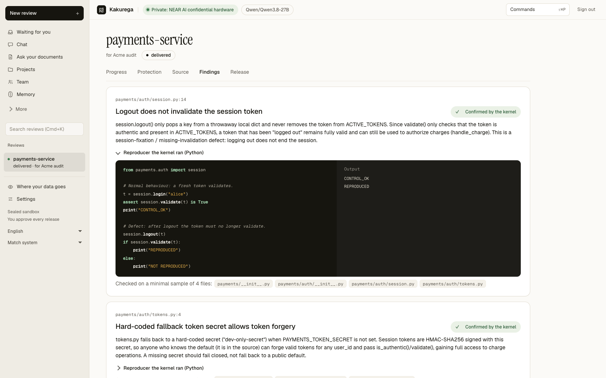
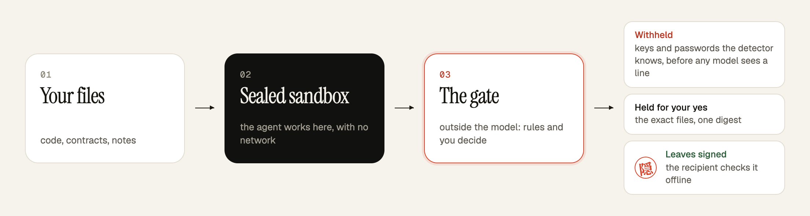
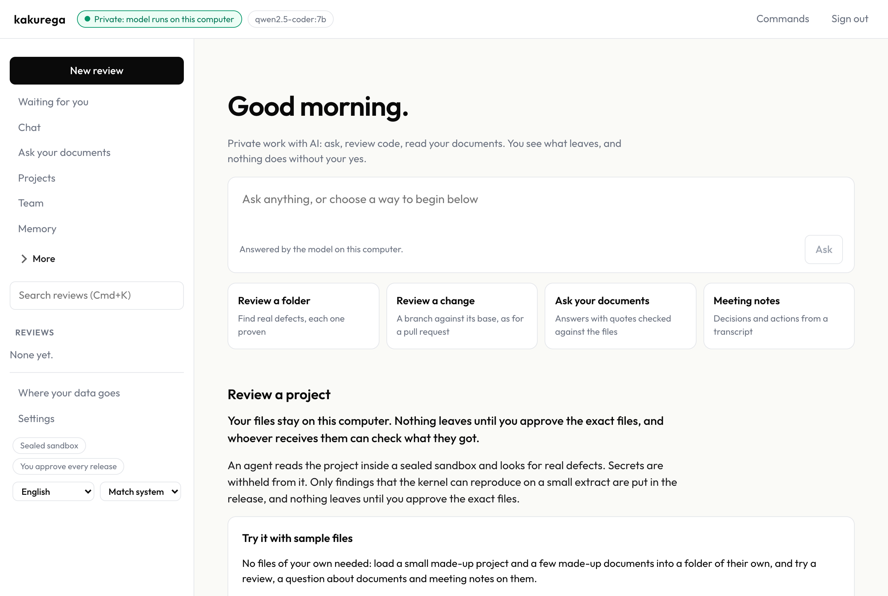
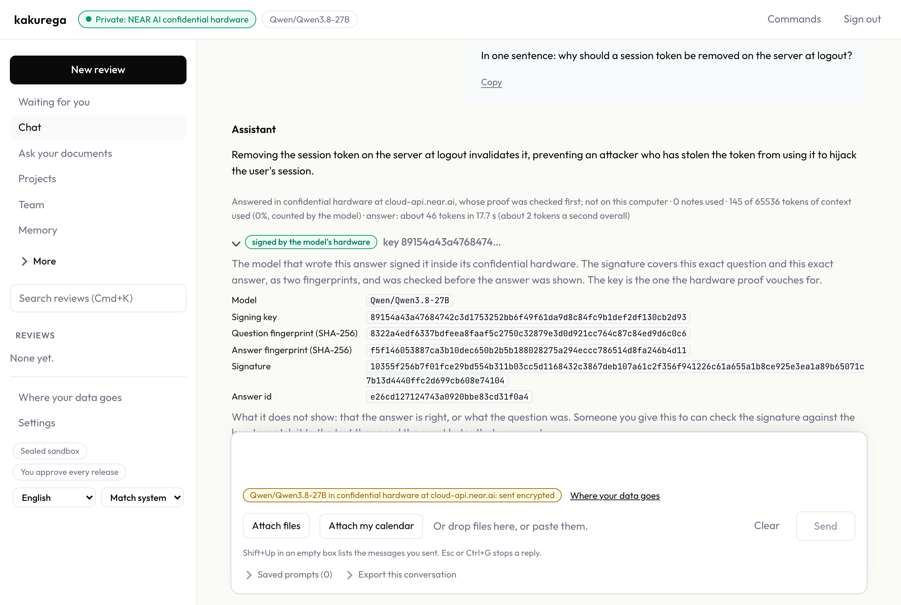

# Kakurega 隠

**A private AI workspace that proves what it did.** Chat, questions over your documents, meeting notes, memory, a team of experts and a full code review, on your own computer. Keys and passwords are withheld before a model sees them, every finding is reproduced in a sandbox, nothing leaves until you approve the exact bytes, and what leaves is a signed capsule the recipient checks offline. When the model is not on your computer it runs in confidential hardware on NEAR AI Cloud, and its proof is checked before every question.

Built at NEAR HACKATHON · Tracks: Privacy & Private AI (primary), AI Security & Defense · [Live site](https://kakurega-eight.vercel.app) · [For judges](docs/JUDGES.md) · [Every feature](docs/FEATURES.md) · [Limits](docs/LIMITS.md)



**The flagship.** "Code review that is fully private - agent that verifiably privately runs code review on private PRs using @near_ai" is on Illia Polosukhin's public list of things to build on NEAR ([post](https://x.com/ilblackdragon/status/2106269343881519444)). `kaku review DIR --for WHO --change main` is that review, and the workspace around it uses the same protections for everything else you do with a model.

Working prototype on macOS and Linux, with NEAR on testnet. Not a finished product: read [the limits](docs/LIMITS.md) before relying on it.

**One command, no key, no account** (needs Rust; the first build takes several minutes):

```
scripts/judge
```

It prints one line per check and exits 0 only if all pass: the program builds, a real review's capsule from NEAR AI Cloud verifies offline, the same capsule with one byte changed is refused, the signed leak benchmark shows 0 of 126 known secret shapes leaked, the capsule registered on NEAR re-checks with every model signature, and NEAR testnet answers that its verifier vouched for the model key and that the registry holds the capsule. The last line says what it does not cover.

> **Try it in two minutes, nothing to install**
>
> 1. Open [https://kakurega-eight.vercel.app/#see](https://kakurega-eight.vercel.app/#see). A replay of a real review of a small made-up payments service, run on NEAR AI Cloud and read from the capsule it produced: the findings the kernel reproduced and the exact files approved, with the model and its signatures. (Step 1's description of the project is written by us; a capsule does not record what was held back.)
> 2. At its last step press **Check the real capsule**: your browser verifies every signature in it. Then press **Change one byte and check again**: refused.
> 3. Open [https://kakurega-eight.vercel.app/verify/](https://kakurega-eight.vercel.app/verify/) and drop [the same capsule](https://kakurega-eight.vercel.app/sample/review.kkg) on it. Nothing is uploaded. You get the verdict, each model signature, and a list of what the check does not establish.
>
> 4. Open [https://kakurega-eight.vercel.app/proof/](https://kakurega-eight.vercel.app/proof/). Your browser asks NEAR's public RPC six questions about the contract (no access keys, code hash, the model key NEAR's verifier vouched for, a paid order, live counts) and compares each answer. The same claims as data, for a program: [proof.json](https://kakurega-eight.vercel.app/proof.json), [llms.txt](https://kakurega-eight.vercel.app/llms.txt).
>
> 5. Open [https://kakurega-eight.vercel.app/try/](https://kakurega-eight.vercel.app/try/) and press **Withhold, check, ask**. Your browser withholds the two keys in the sample with Kakurega's own detector, checks NEAR AI Cloud's hardware proof, sends the rest sealed to the model's key, and checks the model's signature on the answer. A few free tries run on a small key of ours; when they are used up the page asks for your own NEAR AI key.
>
> With a terminal and nothing built: [ask NEAR yourself](#ask-near-yourself) which model key NEAR's own verifier contract vouched for. It is the key that signed every answer in that capsule.



**Contents:** [The problem](#the-problem) · [What it does](#what-it-does) · [How it works](#how-it-works) · [Why NEAR](#why-near) · [What you still have to trust](#what-you-still-have-to-trust) · [Check it yourself](#check-it-yourself) · [Proof of protection](#proof-of-protection) · [Features and state](#features-and-state) · [What it costs](#what-it-costs) · [Run it](#run-it)

## The problem

To get help from an AI you hand it your code, your contracts and your meeting notes, and then you trust three things you cannot see:

- that the model was not talked into leaking them by a line planted in a file;
- that the provider runs what it says it runs;
- that the answer you forward to a client is what the model really produced.

A promise in a privacy policy covers none of the three.

Kakurega is for people who must give an outside party a result from private material: a security reviewer sending findings to a client, a lawyer answering from a contract set, a founder sharing diligence answers.

## What it does

1. **Works on your files and withholds what must not travel.** An agent reviews a project inside a sealed sandbox with no network. Keys, and passwords said as passwords, are withheld from what Kakurega reads for you, on these paths: reviews, attached files, documents, meeting notes, team runs. What you type yourself into a message to a model on this computer is sent as written; the benchmark counts those cases apart. What the detector misses is [counted below](#proof-of-protection).
2. **Decides what leaves, outside the model.** The model cannot send anything. A release is exact files with a digest; you read them and approve that digest, and nothing else goes. Instructions planted in a file are labelled as untrusted text, and whatever a model makes of them it has no way to send anything.
3. **Keeps only what it could prove.** Every finding comes with a script. The kernel runs it on a minimal extract, where it must first show the normal behaviour working and then the defect, print the same result twice, and stop showing the defect when the cited file is emptied. A quote from a document or a transcript is kept only when it is really in the file.
4. **Gives the recipient something to check.** The result is a signed capsule. The recipient checks it offline, in a one-file web page or with one command, and is told what the check does not establish.
5. **Checks confidential hardware when the model is not on your computer.** Before a question may go to NEAR AI Cloud, its Intel TDX and NVIDIA evidence is checked against a fresh challenge, and every answer's signature is checked against the attested key before you see it. NEAR's own verifier contract can record that check on chain, so a recipient can read that record from NEAR and need not take our word for it.

| | | |
| --- | --- | --- |
| <br><sub>One box to ask in, six ways to begin.</sub> | <br><sub>The exact release and its digest, before anything is asked of you.</sub> | <br><sub>An answer from confidential hardware, with the signature of the model that wrote it.</sub> |

## How it works

One review, from folder to recipient:

| Step | What happens | Code |
| --- | --- | --- |
| 1. Read | The agent reads the project in a sandbox with no network (bubblewrap on Linux; on a Mac, a Linux virtual machine). Files and lines holding keys and passwords, and the files you list in `.kakuignore`, are withheld. Every tool call goes through the broker. | `crates/kk-sandbox`, `crates/kk-broker`, `crates/kk-secrets` |
| 2. Prove | Each reported defect must come with a script. The kernel runs it as described above and keeps only what reproduces. | `crates/kk-review/src/check.rs` |
| 3. Release | The kernel lists the exact files, each one's SHA-256 and the release digest. Nothing goes until you approve that digest in the desktop window (Touch ID), the terminal workspace or `kaku approve`. | `crates/kk-service/src/service.rs`, `crates/kk-evidence/src/approval.rs` |
| 4. Sign | The release becomes a signed capsule that names the recipient. When the model ran in confidential hardware, it also carries the model's signature for every answer. | `crates/kk-evidence/src/capsule.rs` |
| 5. Check | The recipient opens it in the one-file check page or runs `kaku verify FILE`. A second verifier, written in JavaScript, is held to the same test vectors. | `apps/verifier-page`, `packages/verifier-js`, `fixtures/capsule` |
| 6. Record, if you choose | `kaku chain register` publishes the capsule's digest and its model receipts on NEAR testnet, after showing exactly what becomes public. | `contracts/kakurega-registry` |

## Why NEAR

The flagship is the private code review Illia Polosukhin asked for (quoted at the top): `kaku review DIR --for WHO --change main` reviews a branch against its base as for a pull request, on a model in NEAR AI Cloud's confidential hardware, with every answer signed by that model's key and every finding reproduced in a sandbox. It reads the repository on your computer; it does not connect to GitHub.

| NEAR piece | What it does here | State |
| --- | --- | --- |
| NEAR AI Cloud attestation | Intel TDX quote, NVIDIA evidence and the model's signing key, bound to a fresh challenge; the deployment compared with NEAR's own releases | Live, no key needed: the proof panel in chat, and `/proof` in the terminal workspace |
| NEAR's on-chain TDX verifier | The registry contract hands a model's quote to NEAR's verifier contract and records the key it vouched for | Live on testnet: [`EqCuP7TZ…`](https://testnet.nearblocks.io/txns/EqCuP7TZmqsgotmj1go7oFg2mzN2qnzRKgmNeXzfhmY) (185.9 Tgas), the key of `Qwen/Qwen3.8-27B` that signed every answer of the paid review below |
| Capsule registry | Who registered a capsule and when, and that every model signature it carries verified (up to 128), readable by anyone from a public RPC | Live on testnet: `kakurega-registry-c68af3.testnet`, with no access keys left, so its code and fee cannot be changed |
| Orders | Money for a review is held and paid only when the named reviewer registers a capsule for that order. 2% on top goes to a fee account fixed in the contract, and comes back with the money if the deadline passes. An order can require that every answer was signed by a model key whose hardware NEAR's verifier checked after the order opened | Live on testnet, with a real review from NEAR AI Cloud: an order requiring hardware opened ([`FNkzwEcy…`](https://testnet.nearblocks.io/txns/FNkzwEcy936xnhG7seUdMKMxj9VhfTSY5FeczmUG6qex)), paid on the registered capsule with all 20 model signatures verified ([`HvDR4pNU…`](https://testnet.nearblocks.io/txns/HvDR4pNUarYwdALySuJR5zNjzxNE7zmxh5KwfXTreSpT), 13.1 Tgas), fee sent ([`FGByqS83…`](https://testnet.nearblocks.io/txns/FGByqS83yQgdRE7S272nw7CtRkg672fgp6N5nj2BKMiJ)). A USDC order is tested on a local node only |
| NEAR AI Cloud inference | Questions encrypted to a model in a TEE; each answer's signature checked against the attested key. Reviews, project questions, coding, teams, chat and documents all run on it | Live with `Qwen/Qwen3.8-27B`, every model-using feature run by the builder through the real screens, on the web and in the terminal. The real capsule is in `fixtures/near-live/` and is re-checked offline by `cargo test -p kk-evidence --test near_live`. Activity shows the cost at NEAR's published price |
| NEAR Intents | A price for paying an order from another chain | Dry quotes only (`kaku chain quote`); nothing is sent |

Take NEAR away and the private cloud route goes, and with it the public record of the hardware check that a recipient can read without us. Only the model on your own computer would remain.

## What you still have to trust

Kakurega narrows what you take on faith; it does not remove it.

- **Your computer and your account.** The service, its keys and its log live there. A program running as you, an agent with a shell included, can read the service's files. An approval key that asks for Touch ID (`kaku approver enroll --enclave`) keeps approvals yours; the real Touch ID prompt has been tested only with the system prompt stubbed.
- **The secret detector.** Shapes it knows did not leak in the benchmark (0 of 126). A password or a code written with no word saying what it is can (10 of 42 did, each named in the signed results). Names are hidden from a model elsewhere only when you listed them.
- **The sandbox on a Mac.** Reviews run in a Linux virtual machine with no network. That is a development arrangement, not a hardened macOS sandbox.
- **Confidential hardware, when you choose it.** Kakurega checks the Intel TDX and NVIDIA evidence against a fresh challenge, and each answer's signature. It cannot inspect the chips, and it relies on Intel's and NVIDIA's published collateral and verification services. Live answers from NEAR AI Cloud were run with one model (`Qwen/Qwen3.8-27B`); other models there are untested.
- **What a capsule proves.** Who signed it, that every file is exactly what was approved, who it was made for, and each finding's check for re-running. It does not prove that nothing was missed.
- **Our code.** Reviewed by the builder and by separate AI reviewers given the code and no conclusions; every finding and its fix is in `docs/engineering-decisions/audit-validation.md`. No outside audit yet.

Every limit, with the reason, is in [docs/LIMITS.md](docs/LIMITS.md).

## Check it yourself

No keys and no funds are needed for any of these. Step by step, with the exact output to expect: [docs/JUDGES.md](docs/JUDGES.md).

| Time | Do | See |
| --- | --- | --- |
| 2 min | Open [https://kakurega-eight.vercel.app/#see](https://kakurega-eight.vercel.app/#see), then [https://kakurega-eight.vercel.app/verify/](https://kakurega-eight.vercel.app/verify/). Nothing to install | The replay of a real review; its capsule checked in your browser; the same capsule refused after one byte is changed |
| 1 min | The two `curl` commands under [Ask NEAR yourself](#ask-near-yourself). Nothing to build | NEAR's own verifier vouched for the model key; the registry holds a real review's capsule with 20 verified model signatures, for order 1 |
| 1 min | `target/debug/kaku chain hardware 89154a43a47684742c3d1753252bb6f49f61da9d8c84fc9b1def2df130cb2d93` | Read from NEAR testnet: the model key, "NEAR's verifier checked its Intel TDX quote", the patch level, and three lines on what this does not establish |
| 1 min | `target/debug/kaku bench verify benchmarks/leak/results.signed.json --pin "$(cat benchmarks/leak/signer.pub)"` | "Signature: checks against the pinned key." then the counts: known shapes 126 cases, leaked 0; beyond the detector 42 cases, leaked 10, each one named |
| 5 min, mostly the first build | `scripts/judge` (needs Rust) | Seven lines, each `PASS`: build, a real capsule valid, an altered one refused, the leak benchmark, the registered capsule re-checked, and two answers from NEAR testnet. Exit 0 |
| 3 min | `scripts/judge-replay` (needs Rust, Node and pnpm; it installs the JavaScript packages itself) | A good capsule accepted and a forged one refused, from the command line; then open `apps/verifier-page/dist/kakurega-verify.html` (the script builds it) from disk and drop the capsule on it |
| 5 min | `scripts/check-deployed` (needs `cargo near`) | The contract is built here and its hash compared with the code NEAR reports for the testnet account: MATCH on the machine that deployed it. The build is not the reproducible (Docker) one, so another machine may produce different bytes; the script then prints both hashes and exits 1 |
| 20 min | `scripts/test` | Lints, unit and integration tests, the layer rule and the secret scan, exit 0 |
| An hour | `scripts/e2e-all` | Every end-to-end script: a real browser, the terminal, the desktop app, MCP, the extension |

The `kaku` rows need one build first: `cargo build -p kk-cli` (Rust is pinned in `rust-toolchain.toml`). The `curl` commands and `kaku chain hardware` ask a public NEAR RPC and nothing of ours. The benchmark can be run again from scratch with `benchmarks/leak/reverify --rerun`.

The check page `apps/verifier-page/dist/kakurega-verify.html` (built by `scripts/judge-replay`, or `node apps/verifier-page/build.mjs`; the same page is live at https://kakurega-eight.vercel.app/verify/) is one file: open it from disk in any browser, drop a capsule on it, and optionally paste the signer key you expect. Nothing is uploaded. The network is used only if you press the NEAR lookup under a valid result, which sends the capsule's digest and the keys named in it to a public NEAR server. The page lists each model signature in the capsule and says what the check does not establish, including that a model's key is not shown to belong to attested hardware.

### Ask NEAR yourself

A model key that NEAR's own TDX verifier contract vouched for, read from a public RPC. None of our code is involved.

```sh
ARGS=$(printf '{"signer":"89154a43a47684742c3d1753252bb6f49f61da9d8c84fc9b1def2df130cb2d93"}' | base64 | tr -d '\n')
curl -s https://rpc.testnet.fastnear.com -H 'content-type: application/json' -d '{"jsonrpc":"2.0","id":1,"method":"query","params":{"request_type":"call_function","finality":"final","account_id":"kakurega-registry-c68af3.testnet","method_name":"hardware","args_base64":"'"$ARGS"'"}}' | python3 -c "import json,sys; print(bytes(json.load(sys.stdin)['result']['result']).decode())"
```

Expected: JSON that starts `{"signer":"89154a43…","tcb_status":"UpToDate","advisory_ids":[],"mr_td":"df4d77c8…`.

The capsule of a real review that ran on that model, registered for a paid order that required this hardware record:

```sh
ARGS=$(printf '{"capsule_sha256":"2d2f9450a88fab653909a09c3c1a992929e308a0120feb5380a13ea381b99f8b","capsule_signer":"d48949fd672796dd58880341608d6a2fc26e28ade3f323a24792226a324a43ee"}' | base64 | tr -d '\n')
curl -s https://rpc.testnet.fastnear.com -H 'content-type: application/json' -d '{"jsonrpc":"2.0","id":1,"method":"query","params":{"request_type":"call_function","finality":"final","account_id":"kakurega-registry-c68af3.testnet","method_name":"get","args_base64":"'"$ARGS"'"}}' | python3 -c "import json,sys; print(bytes(json.load(sys.stdin)['result']['result']).decode())"
```

Expected: `"receipt_count":20`, one signer `89154a43…` for `Qwen/Qwen3.8-27B` with `"receipts":20`, and `"order":"1"`. The capsule itself is `fixtures/near-live/review.kkg`; its SHA-256 is the `capsule_sha256` above. It is an earlier review than the sample on the site (`fixtures/near-live/sample.kkg`, made valid for a year); it was made to expire after a day, so a check today reports it expired, and `cargo test -p kk-evidence --test near_live` checks it as of the minute it was made. Both sides of that order were the builder's own testnet accounts.

What this does not show: which software ran (the measurements are recorded, none is approved by the contract), anything about the GPU, or whether the review's findings are right.

## Proof of protection

| What was measured | Result | Sample and method |
| --- | --- | --- |
| Leaks of secret shapes the detector knows | **0 of 126 leaked.** 90 were held back, 18 refused before any model was asked, and 18 were typed into a message by the owner, which is sent as written to a model on this computer | 168 cases through seven doors, against a model that repeats every secret it is shown. Signed results. `benchmarks/leak/METHOD.md` |
| Leaks of shapes it does not know: a password or a PIN written with no word saying what it is, or made of ordinary words | **10 of 42 leaked**, and the signed results name each one | The same benchmark |
| A file with a made-up key and one planted instruction, summary asked for | A plain prompt repeated the key in **4 of 16** attack runs. With the file attached in Kakurega the key was sent **0 of 18** times, because its line is withheld | Small sample, two different models; the limits are in `benchmarks/injection/METHOD.md` |
| Review quality on a small project with one planted defect and a 7B local model | The plain model found it 3 of 3 with **13** false findings. The verified loop found it 3 of 3 with **0** false findings, at about 150 seconds a review | One project, one defect. `benchmarks/quality/METHOD.md` |

**Try to break it.** The app has a box where you write your own attack next to two fresh secrets and see exactly what the model was sent.

## Features and state

Everything in the product, with its state today and how each row was checked, is in [docs/FEATURES.md](docs/FEATURES.md#the-state-of-each-feature). In short:

| Area | What is there | State |
| --- | --- | --- |
| Review and release | Private review of a project or a change, findings reproduced by the kernel, approval of the exact bytes, a signed capsule checked offline | Works |
| Workspace | Chat with your notes and files, questions over documents with checked quotes, meeting notes, memory, a team of experts, a roundtable, questions and changes on a codebase, skills | Works |
| Protection | Keys and passwords withheld, planted instructions passed as data, a sandbox with no network, a signed activity log, "Where your data goes" | Works, within the limits stated above |
| NEAR | Confidential inference with the proof checked first, a signed receipt under every answer, the hardware record and capsule registry on testnet, orders that pay on a registered capsule | Live on testnet |
| Where it runs | Browser, desktop app (macOS, Linux), full-screen terminal, browser extension, Telegram (read-only), MCP server | Works; the desktop app is an unsigned build |
| Not built | Windows, mobile, hosted mode, encrypted sync between devices | Not built |

## What it costs

| What | Who pays | Today |
| --- | --- | --- |
| The workspace, for personal and work use | Nobody: no account, it runs on your computer with a local model | Free |
| A model on NEAR AI Cloud | You, to NEAR AI, by use, from your own account | Activity shows what each route cost, at NEAR's published price unless you entered one |
| A review sold to a client | The client, through an order on NEAR. Kakurega's fee is 2% on top, earned only when the order pays | Orders run on testnet; nothing is charged |

A paid plan for teams waits for hosted mode, which is not built.

<details>
<summary><b>How an order pays, and why 2%</b></summary>

The client sets aside the agreed amount and names the reviewer, the key that will sign the capsule, the scope and a deadline. The contract pays the reviewer the whole amount only when that reviewer registers a capsule for that order, signed by that key, before the deadline. The 2% fee is paid by the client on top and earned only then; if the deadline passes, anyone can send the amount and the fee back to the client. The rate and the one account fees can go to are fixed when the contract is created: there is no admin and no upgrade, so the fee cannot be raised later. A client paying in USDC first sets a little NEAR aside at the registry (about 0.01, taken back with `kaku chain storage ACCOUNT --withdraw --key-file FILE`) for the order's record, so the registry never pays for anyone's storage.

Why this price: local AI workspaces are free to run (LM Studio is free for work, AnythingLLM's desktop app is free), so the workspace is free too. The fee sits where Kakurega adds what others cannot: a payment released by checked evidence. It is lower than marketplaces that also triage and settle disputes (Immunefi and Sherlock charge 10% on bounty payouts, Upwork about 5% to clients plus a fee to freelancers) and close to escrow services (Escrow.com, about 0.9% to 3.25%), because nobody here judges quality or settles disputes.

</details>

## Run it

On macOS:

```
scripts/setup                        # dependencies, the web build and the kaku program
ollama serve &                       # the local model service
ollama pull qwen2.5-coder:7b         # the model reviews and answers use when none is named
scripts/provision-vm                 # the sandbox machine reviews run in (Lima, Ubuntu); safe to run again
target/debug/kaku doctor             # every check should say ok
target/debug/kaku                    # full-screen workspace; starts the service if needed
target/debug/kaku serve              # or the browser workspace: prints a one-time pairing link
```

To answer on NEAR AI Cloud's confidential hardware instead: `kaku serve --route near --near-model Qwen/Qwen3.8-27B --near-key-file FILE`, where FILE holds a line `NEAR_AI_API_KEY=...` and is readable by you only, or type the key in Settings.

<details>
<summary><b>Desktop app and Linux package</b></summary>

Desktop: `cd apps/desktop && pnpm install && pnpm start` with `KAKU_BIN` pointing at the built `kaku`. A self-contained macOS app is built by `scripts/package-desktop-macos` (a zip and its SHA-256) and installed by `scripts/install-desktop-macos`, which checks the SHA-256 before it unpacks anything. The app is signed ad hoc only and is not notarized. It stays in the menu bar and tells you when something waits for you.

Linux package: `scripts/package-linux` builds and checks a `.deb` in the Linux VM and copies it to `target/packaged-linux/` (install with `sudo dpkg -i`, start with `kakurega`).

</details>

<details>
<summary><b>Run the test suites</b></summary>

```
scripts/test                         # lints, unit and integration tests, layer rule, secret scan (not the end-to-end scripts)
scripts/e2e                          # a real browser drives a full review, approval, memory, chat and log
scripts/e2e-all                      # every end-to-end script: browser, terminal, MCP, Telegram, extension, desktop, signed approvals
scripts/test-lima                    # the sandbox and worker tests inside the Linux VM
python3 scripts/verify_program.py I  # the acceptance gate for a milestone (also II and III)
```

`program/ACCEPTANCE_MANIFEST.json` lists every acceptance row with the command that proves it; rows that need a person or an external key say so. [docs/TESTING.md](docs/TESTING.md) says what each suite covers, what runs only by hand, and why.

</details>

<details>
<summary><b>Layout</b></summary>

- `crates/` Rust crates (trusted core). The layer rule in `scripts/layers.json` is checked by `scripts/check_layers.py`.
- `apps/` web workspace, desktop app, browser extension, the standalone capsule check page, the public site.
- `contracts/` the NEAR capsule registry contract (testnet only; a separate Cargo project built with `cargo near`).
- `packages/` shared TypeScript packages (canonical JSON, capsule verifier).
- `fixtures/`, `tests/` test inputs and cross-component tests.
- `benchmarks/` the leak, injection and quality benchmarks, each with its method.
- `docs/engineering-decisions/` one record per component: target experience, what was read, decision, evidence, what is not covered.
- `docs/mcp.md` the MCP server. `docs/LIMITS.md` what is and is not claimed.
- `program/` acceptance manifest and the parity registry of every planned capability.

</details>

## Requirements

git, Rust (version pinned in `rust-toolchain.toml`), a C compiler and perl (the encrypted store builds OpenSSL from source, so the first build takes several minutes), Node 22.19 or newer, pnpm, Python 3. macOS also needs Lima for the sandbox; Linux needs bubblewrap. A model on your own computer needs Ollama. Windows is not supported.

A recipient who gets a release with a JavaScript finding needs Python 3 and Node.js 22 or newer to re-run its check; without Node the runner says so and still checks the other findings.

## Libraries and AI-written code

- **When it was written:** every commit in this repository dates from 3 November 2026 on; there is no earlier code and no other repository behind it.
- **Libraries and code taken from others:** every one is listed with its licence, and what was used from it, in [NOTICE.md](NOTICE.md). Nothing was copied from a project that is not permissively licensed.
- **AI-written code:** most of the code, tests and documents in this repository were written with AI coding assistants (Claude Code), directed, reviewed and tested by the builder. The separate code audits recorded in `docs/engineering-decisions/audit-validation.md` were also run with AI reviewers that were given the code and no conclusions.

## Licence

Kakurega is licensed under the [Apache License, Version 2.0](LICENSE). Copyright 2026 the Kakurega authors. Third-party code and libraries keep their own licences; each is credited in [NOTICE.md](NOTICE.md).

